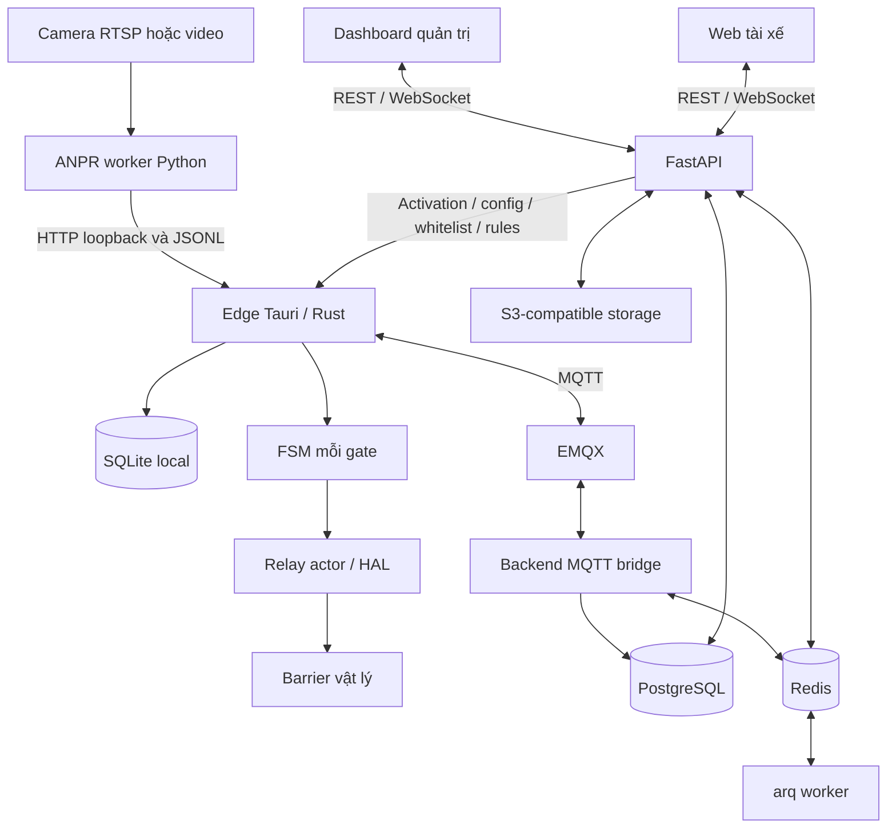

# ParkVision

Hệ thống quản lý bãi xe đa tenant, kết hợp nhận diện biển số (ANPR), ứng dụng trực cổng, web quản trị và web dành cho tài xế.

Tài liệu được rà soát từ mã nguồn trong repository. Mô tả “có trong source” không có nghĩa đã được nghiệm thu với camera, barrier hay cổng thanh toán thật. Các bản thiết kế trong `docs/superpowers/` là lịch sử thiết kế, không thay thế hành vi implementation hiện tại.

## Các thành phần

- **[`backend/`](backend/README.md)** — FastAPI, PostgreSQL/RLS, Redis, MQTT bridge và arq worker. Quản lý tenant, quyền, bãi/cổng/camera, xe, sự kiện, vị trí, membership và thanh toán.
- **[`frontend/`](frontend/README.md)** — React/TypeScript/Vite; dashboard platform và tenant, cookie session/CSRF, telemetry WebSocket.
- **[`mobile/`](mobile/README.md)** — React/Vite SPA giao diện mobile cho tài xế: tìm bãi, xe cá nhân, phiên đỗ xe, hội viên, thanh toán và ví. Không phải ứng dụng Android/iOS native.
- **[`edge-client/`](edge-client/README.md)** — Tauri 2/Rust/React trên máy trực cổng; activation, cache SQLite, quyết định local, FSM từng cổng, hàng đợi offline và relay HAL.
- **[`anpr-worker/`](anpr-worker/README.md)** — Python/OpenCV/YOLO/PaddleOCR; xử lý camera, tracking, OCR, lưu snapshot và gửi kết quả tới HTTP ingest của edge.

## Kiến trúc tổng quan



Đường monitor-camera MQTT để cập nhật vị trí xe là hợp đồng riêng; Python worker hiện **không tự publish** hợp đồng đó. Xem [hợp đồng camera detection](docs/mqtt-camera-detection.md).

### Ranh giới quan trọng

1. **Backend** giữ dữ liệu nghiệp vụ và phân quyền; không chạy OCR hay trực tiếp điều khiển relay.
2. **Edge** quyết định local dựa trên cache đã sync; mạng mất không đồng nghĩa mọi nghiệp vụ online như thanh toán đều tiếp tục hoạt động.
3. **FSM** tick 50 ms; network/serial I/O relay đi qua actor riêng, không chặn tick.
4. Cấu hình wiring `gates[].barrier` nằm ở edge; refresh backend phải giữ cấu hình local khi `gateId` không đổi.
5. HTTP nhận command, ACK command và barrier thực sự chuyển động là ba mốc khác nhau. Không coi HTTP 202 là bằng chứng xe đã qua cổng.

## Bắt đầu phát triển

### 1. Chuẩn bị

- Docker Engine/Desktop có Compose để chạy hạ tầng backend.
- Node.js/npm cho các web app; CI dashboard dùng Node 24, Docker frontend dùng Node 20. Xem dependency thực tế trong từng `package-lock.json`.
- Python theo yêu cầu từng module; backend image dùng Python 3.12. ANPR cần dependency/model riêng, không dùng chung mặc định với backend.
- Rust và toolchain Tauri nếu chạy edge native; Windows cần MSVC Build Tools và WebView2. Xem [edge README](edge-client/README.md).

Không cài dependency chung ở gốc repo: từng module có môi trường và lệnh riêng.

### 2. Chạy backend

Từ `backend/`:

```sh
cp .env.example .env
# Sửa .env cho môi trường Docker trước khi chạy; xem backend/README.md.
docker compose up -d --build
docker compose exec api python -m scripts.seed
```

PowerShell có thể dùng `Copy-Item .env.example .env`. Không ghi đè `.env` đã có. Nếu checkout không chứa `.env.example`, tạo `.env` theo các biến trong [backend README](backend/README.md) và [`app/config.py`](backend/app/config.py).

**Phải kiểm tra địa chỉ mạng trong `.env`:** tiến trình container dùng `postgres`, `redis`, `emqx`, `mailpit`; tiến trình chạy trên host dùng `localhost` và cổng được publish. S3 endpoint còn phải truy cập được từ bên dùng presigned URL; [hướng dẫn vận hành](docs/development-and-operations.md) giải thích ràng buộc này.

- API: <http://localhost:8000>; Swagger: <http://localhost:8000/docs>.
- Mailpit: <http://localhost:8025>; EMQX dashboard: <http://localhost:18083>.
- Seed dev: platform `admin@example.com` / `ChangeMe!123`; tenant owner `owner@demo.example.com` / `DemoOwner!123`. Không dùng tài khoản mẫu ngoài môi trường phát triển.

### 3. Chạy dashboard và web tài xế

Terminal dashboard, từ `frontend/`:

```sh
npm ci
npm run dev
```

Terminal tài xế, từ `mobile/`:

```sh
npm ci
npm run dev -- --port 3001
```

Hai script mặc định cùng chọn cổng 3000, vì vậy ví dụ trên chủ động dùng 3001 cho mobile. Dashboard proxy `/api` và `/ws`; mobile dev hiện chỉ proxy `/api`.

- Dashboard proxy target: biến môi trường tiến trình `VITE_API_PROXY_TARGET`.
- Mobile proxy target: biến môi trường tiến trình `VITE_API_PROXY`.
- Mặc định cả hai target là `http://localhost:8000`.
- Mobile WebSocket cần cấu hình riêng; xem [mobile README](mobile/README.md).
- Các biến proxy trên đọc từ `process.env` của Vite config; không mặc định cho rằng đặt vào `.env` là tự áp dụng.

### 4. Kết nối edge và camera

1. Tạo site/lane/gate và edge device bằng tenant dashboard/API.
2. Gán gate/device và tạo activation code.
3. Chạy edge native, nhập API base có `/api/v1` và mã kích hoạt.
4. Kiểm tra whitelist/rules đã sync trước khi thử quyết định local.
5. Cấu hình camera, model và sidecar theo [ANPR docs](docs/anpr-worker.md).
6. Cấu hình và probe relay theo [barrier relay setup](docs/barrier-relay-setup.md), nghiệm thu an toàn tại hiện trường.

**Không xem pipeline camera là plug-and-play:** source hiện có chênh lệch ACK HTTP, tên multipart ảnh và `ocr.comparators` giữa Python/Rust. Các giới hạn và điểm đối chiếu được ghi ở [ANPR docs](docs/anpr-worker.md) và [edge docs](docs/edge-client.md). Tài liệu này không sửa mã tích hợp đó.

## Đọc tài liệu theo nhu cầu

- [Mục lục toàn bộ docs](docs/README.md).
- [Phát triển, triển khai và vận hành](docs/development-and-operations.md): topology mạng, thứ tự khởi động, health, test, CI và troubleshooting.
- [Backend chi tiết](docs/backend.md): auth/RBAC/RLS, API, nghiệp vụ, DB, workers, payment và giới hạn.
- [Hai web app](docs/web-apps.md): màn hình, auth, state, API/realtime và phần demo/chưa nối đủ.
- [Edge chi tiết](docs/edge-client.md): config v3, activation/merge, FSM, offline queue, MQTT, HAL và secret.
- [ANPR chi tiết](docs/anpr-worker.md): motion/tracking/OCR, model, config, HTTP/IPC, queue/retry và Docker CPU/GPU.
- [MQTT monitor-camera](docs/mqtt-camera-detection.md): topic/payload, zone resolution, presence và WebSocket.
- [Backup và khôi phục](docs/RUNBOOK_BACKUP_RESTORE.md): PostgreSQL, ảnh S3 và dữ liệu local edge.

## Kiểm tra trước khi gửi thay đổi

Chạy trong từng thư mục, không chạy tất cả từ gốc:

```sh
# frontend/
npm run lint
npm run build

# mobile/
npm run lint
npm test
npm run build

# edge-client/
npm run lint
npm run build

# edge-client/src-tauri/
cargo test
```

Backend integration test có thể drop/recreate schema: **chỉ dùng database test riêng**. Các lệnh backend/ANPR, prerequisite và giới hạn kiểm chứng nằm trong [hướng dẫn kiểm thử](docs/development-and-operations.md#5-kiểm-thử-và-ci).

## Lưu ý triển khai

Compose là baseline phát triển: mật khẩu mẫu, MQTT anonymous và nhiều cổng hạ tầng được mở ra host. Production cần TLS, MQTT auth/ACL, secret riêng, cookie Secure, giới hạn mạng, backup đã diễn tập và nghiệm thu thiết bị. Xem [checklist vận hành](docs/development-and-operations.md#7-checklist-trước-triển-khai).
