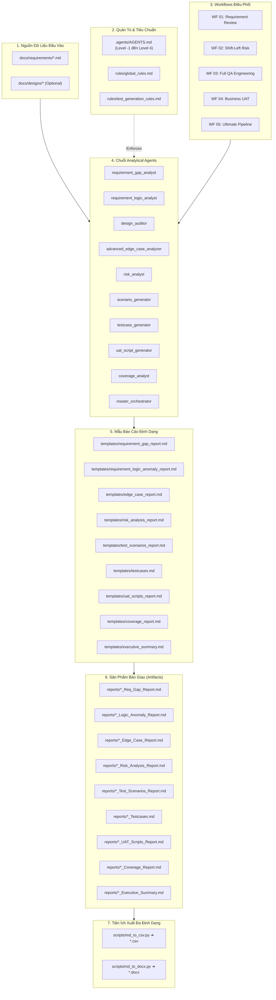

# 🏛️ RideArc QA Auto Kit — Comprehensive Repository Audit & Baseline Report
> **Tài liệu bàn giao Phase 1 (Delivery of Phase 1: Audit & Baseline)**  
> **Phiên bản Framework:** v3.1.0 | **Ngày kiểm toán:** 2026-10-14  
> **Phạm vi:** Toàn bộ `agents/`, `workflows/`, `rules/`, `templates/`, `scripts/`, `.agents/`, `docs/`, `reports/`

---

## 1. 📌 Tóm Tắt Kết Quả Kiểm Toán (Executive Summary)

Repo `RideArc` (v3.1.0) đã đạt mức độ trưởng thành cao (**Mature Production Baseline**) về mặt năng lực phân tích yêu cầu và sinh testcase manual/UAT. Framework sở hữu hệ thống quy tắc quản trị cấp cao chống hallucination (`.agents/AGENTS.md`) và bộ 65 quy tắc sinh test (`rules/test_generation_rules.md`) cực kỳ chặt chẽ, cùng với các output thực tế chất lượng cao trong `reports/`.

Tuy nhiên, quá trình kiểm toán thực tế phát hiện **5 khoảng trống kỹ thuật (Technical Gaps)** cần được chuẩn hóa ở các Phase tiếp theo để toàn bộ đội ngũ QC có thể sử dụng đồng bộ và đáng tin cậy:

| # | Điểm phát hiện | Đánh giá rủi ro | Hướng giải quyết |
|---|---|:---:|---|
| 1 | **Finding ID không thống nhất giữa các Templates**: Mỗi template dùng một format khác nhau (`GAP-001`, `REQ-001`, `RISK-001`, `ANOMALY-001`, `BVA-001`). | 🟠 High (Khó trace chéo) | Chuẩn hóa master finding schema `[TYPE]-[MODULE]-[NNN]` tại **Phase 2**. |
| 2 | **Script CLI Hardcoding**: `scripts/md_to_docx.py` ban đầu hardcode đường dẫn file cụ thể thay vì đọc `sys.argv`. | 🔴 High (Lỗi runtime khi gọi tự động) | **Đã sửa ngay trong Phase 1** — hỗ trợ CLI `python md_to_docx.py <in> <out>`. |
| 3 | **Thiếu Schema Validation tự động**: Output do AI sinh ra chưa có công cụ kiểm tra tự động xem có đủ 14 cột, ID có trùng lặp không. | 🟠 High (Phụ thuộc reviewer) | Xây dựng bộ script kiểm tra (`validate_*.py`) tại **Phase 4**. |
| 4 | **Chưa có Project Context Isolation**: Khi dùng cho nhiều dự án khác nhau (RideArc, Merchant, Admin), business rules dễ bị "nhiễm chéo" qua prompt context. | 🟠 High (Nhiễm context AI) | Thiết lập `projects/_template/` tại **Phase 3**. |
| 5 | **Chưa có Onboarding / Quick Start**: QC mới phải đọc qua 10 agent files và 2 rule files đồ sộ mới nắm được cách dùng. | 🟠 High (Rào cản áp dụng) | Biên soạn `docs/QUICK_START.md` và `.github/copilot-instructions.md` tại **Phase 3**. |

---

## 2. 🤖 Kiểm Kê Toàn Diện 10 Analytical Agents (`agents/`)

| # | Agent Name | Version | Role / Trách nhiệm chính | Required Inputs | Output Artifacts | Dependencies | Status | Ghi chú & Đánh giá |
|---|---|:---:|---|---|---|---|:---:|---|
| 1 | **`master_orchestrator`** | 3.1.0 | Điều phối 5 workflows, kiểm soát luồng chạy tuần tự, kích hoạt export script | `docs/requirements/*` | `reports/*_Executive_Summary.md` | Workflows 01–05 | ✅ Healthy | Đã đồng bộ export CSV & DOCX ở Step 5. |
| 2 | **`requirement_gap_analyst`** | 3.0.0 | Phát hiện lỗ hổng nội tại và truy vết chéo giữa các tài liệu (PRD vs SRS) | `docs/requirements/*` | `reports/*_Req_Gap_Report.md` | Template Gap | ✅ Healthy | Hoạt động rất tốt, đã làm baseline cho WF 01, 02, 03, 04, 05. |
| 3 | **`requirement_logic_analyst`** | 1.0.0 | Thử thách tính hợp lý nghiệp vụ, mâu thuẫn rẽ nhánh, state transition bất thường | `docs/requirements/*` | `reports/*_Logic_Anomaly_Report.md` | Template Logic Anomaly | ✅ Healthy | Mới tích hợp v3.1.0. Rất mạnh về Business Plausibility. |
| 4 | **`design_auditor`** | 3.0.0 | Đối chiếu màn hình UI/UX/Wireframe với SRS để tìm component và error state thiếu | `docs/requirements/*`, `docs/designs/*` | `reports/*_Design_Audit_Report.md` | Template Design Audit | ⚠️ Conditional | Tự động SKIP an toàn nếu `docs/designs/` rỗng. |
| 5 | **`advanced_edge_case_analyzer`** | 3.0.0 | Dò tìm ca biên cực hạn, concurrency, race condition, ngắt quãng trạng thái | `docs/requirements/*` | `reports/*_Edge_Case_Report.md` | Template Edge Case | ✅ Healthy | Đã chuẩn hóa chạy sau Logic Anomaly. |
| 6 | **`risk_analyst`** | 3.0.0 | Nhận diện ma trận rủi ro (Business, Tech, Security, Perf) để phân tầng ưu tiên test | `docs/requirements/*` | `reports/*_Risk_Analysis_Report.md` | Template Risk Analysis | ✅ Healthy | Đã đồng bộ chạy sau Edge Case ở WF 02, 03, 05. |
| 7 | **`scenario_generator`** | 3.0.0 | Sinh kịch bản kiểm thử cấp cao (Scenarios) bao phủ Positive, Negative, Boundary | `docs/requirements/*` | `reports/*_Test_Scenarios_Report.md` | Template Scenarios | ✅ Healthy | Khung xương sống (skeleton) cho Test Case Generation. |
| 8 | **`testcase_generator`** | 4.0.0 | Sinh testcase chi tiết chuẩn 14 cột, áp dụng 65 generation rules và RBT mode | `docs/requirements/*` | `reports/*_Testcases.md` | Template Testcases | ✅ Healthy | Cốt lõi của framework. Rất mạnh và chi tiết. |
| 9 | **`uat_script_generator`** | 3.0.0 | Sinh kịch bản UAT ngôn ngữ kinh doanh (Business Acceptance Journeys) cho Client/PO | `docs/requirements/*` | `reports/*_UAT_Scripts_Report.md` | Template UAT | ✅ Healthy | Đã có baseline check ở WF 04. |
| 10| **`coverage_analyst`** | 3.1.0 | Đo lường độ bao phủ đa chiều (Requirement, Edge Case, Risk), chốt sổ 100% | `docs/requirements/*`, Reports | `reports/*_Coverage_Report.md` | Template Coverage | ✅ Healthy | Bộ quy tắc discovery và tính điểm coverage chặt chẽ. |

---

## 3. 📄 Kiểm Kê 10 Templates Báo Cáo (`templates/`)

| # | Template File | Mục đích sử dụng | Bảng dữ liệu chính | Finding / Item ID Format | Điểm cần chuẩn hóa (Phase 2) |
|---|---|---|---|:---:|---|
| 1 | `requirement_gap_report.md` | Báo cáo lỗ hổng yêu cầu & truy vết chéo | Bảng tóm tắt Severity, danh sách Gaps | `[GAP-NNN]`, `[REQ-NNN]` | Cần sync về `[GAP-MODULE-NNN]` |
| 2 | `requirement_logic_anomaly_report.md` | Báo cáo bất thường logic nghiệp vụ | Bảng Anomaly Register, State Matrix | `ANOMALY-NNN`, `CONTRADICTION-NNN` | Cần sync về `[LOGIC-MODULE-NNN]` |
| 3 | `edge_case_report.md` | Báo cáo các ca kiểm thử biên và rẽ nhánh khó | Bảng ma trận Edge Case & BVA | `EDGE-NNN`, `BVA-NNN` | Cần sync về `[EDGE-MODULE-NNN]` |
| 4 | `risk_analysis_report.md` | Báo cáo phân tích và ma trận rủi ro | Bảng Risk Register 8 cột | `RISK-NNN` | Cần sync về `[RISK-MODULE-NNN]` |
| 5 | `test_scenarios_report.md` | Báo cáo danh mục kịch bản kiểm thử | Bảng Scenarios theo luồng nghiệp vụ | `SCENARIO-NNN` | Đồng bộ format |
| 6 | `testcases.md` | Template chứa bộ Test Cases chi tiết | Bảng chuẩn 14 cột + 65 Applied Rules | `[MODULE]-TC-[NNN]` | Đã chuẩn hóa cấu trúc 14 cột |
| 7 | `uat_scripts_report.md` | Kịch bản nghiệm thu người dùng cuối | Bảng kịch bản UAT End-to-End | `UAT-NNN` | Đồng bộ format |
| 8 | `coverage_report.md` | Báo cáo đo lường độ bao phủ đa chiều | Multi-dimension Coverage Matrix | Mapped Requirement IDs | Đầy đủ và chi tiết nhất |
| 9 | `executive_summary.md` | Báo cáo tổng hợp điều hành SDLC | Tổng kết điểm số, Go/No-Go Gate | Consolidated Finding Counts | Hoạt động tốt |
| 10| `design_audit.md` | Báo cáo đối chiếu UI/UX vs SRS | Bảng sai lệch Component/Flow UI | `DES-GAP-NNN` | Cần bổ sung ví dụ minh họa |

---

## 4. ⚖️ Kiểm Kê Hệ Thống Quy Tắc Quản Trị (Rules & Governance)

### A. `.agents/AGENTS.md` (AI Governance Framework — Level -1 đến Level 4)
- **Vị trí**: Nằm trong thư mục `.agents/` phục vụ điều khiển AI Agent trực tiếp tại IDE/Coding Assistant.
- **Vai trò**:
  - **Level -1**: Input & Document Integrity (Fail-fast Gateway).
  - **Level 0**: Core Governance, Anti-hallucination (`Unknown ≠ Not Applicable`), Quy chuẩn ngôn ngữ (`<RULE[qa_deliverables_language_standard]>`).
  - **Level 1**: Phân loại Requirement & kỹ thuật thiết kế test (State Machine, Decision Table, EP/BVA).
  - **Level 2**: Domain Context Stratification (Ride-Hailing domain context).
  - **Level 3 & 4**: Atomic test generation protocols, Execution Gates.
- **Tình trạng**: Đang là nguồn chuẩn tối cao (Supreme Authority) của toàn bộ framework.

### B. `rules/global_rules.md` (Global Operating Standards)
- **Vị trí**: Quy định dùng chung cho tất cả các Agents.
- **Nội dung**: 10 điều khoản cốt lõi (Zero Hallucination, Evidence-Based, Severity Definitions, Terminology, Language Standard, Naming Convention, Requirement Clarity Gate, Zero Sample Testcases Policy).
- **Đánh giá Overlap**:
  - Section 6 (Language Standard) đã được đồng bộ hoàn toàn với `<RULE[qa_deliverables_language_standard]>` của `AGENTS.md`.
  - Section 3 (Severity Definitions) định nghĩa P0/P1/P2/P3 rất rõ ràng. Cần làm nguồn duy nhất tham chiếu cho schemas tại Phase 2.

### C. `rules/test_generation_rules.md` (Enterprise Test Generation Rules)
- **Vị trí**: Bộ quy chuẩn 65 rules phục vụ trực tiếp cho `testcase_generator.md` và `coverage_analyst.md`.
- **Điểm mạnh vượt trội**:
  - Có Feature Size Evaluation Matrix định mức số lượng test case.
  - Phân định rõ Rule §12.5a (HTML ` ` trong ô bảng) và Rule §12.5b (Artifact Synchronization).
  - Có bộ Self-Audit Engine 7 tiêu chí bắt buộc trước khi lưu file testcase.

---

## 5. 🛠️ Kiểm Kê Bộ Công Cụ & Scripts (`scripts/`)

| Script | Ngôn ngữ / Thư viện | Mục đích | Input | Output | Trạng thái kiểm toán |
|---|---|---|---|---|:---:|
| `md_to_csv.py` | Python (csv, sys, re) | Trích xuất bảng 14 cột, xử lý ` ` thành xuống dòng thật, giữ dấu pipe escaped `\|`, xuất file CSV UTF-8 BOM cho Jira/Xray/TestRail | `*_Testcases.md` | `*_Testcases.csv` | ✅ **Hoạt động hoàn hảo** (Đã test trên baseline 56 records thành công 100%) |
| `md_to_docx.py` | Python (docx, re, xml) | Chuyển đổi Markdown sang Microsoft Word (`.docx`), định dạng bảng, tiêu đề, blockquote, làm sạch công thức toán học LaTeX | `*.md` | `*.docx` | ✅ **Đã khắc phục lỗi hardcode CLI** trong Phase 1, hoạt động mượt mà |

---

## 6. 📊 Phân Tích Bộ Baseline Output Thực Tế (`FR_RID_7_In_Trip_Modifications`)

Để đánh giá chất lượng thực tế, framework đã tiến hành kiểm toán bộ output có sẵn của module `FR_RID_7_In_Trip_Modifications` và lưu bản đối chứng vào `tests/fixtures/baseline/FR_RID_7_In_Trip_Modifications/`:

### Các chỉ số định lượng của Baseline:
- **Tài liệu nguồn:** `Rider App - Feature Requirements Specification (Internal).md` (Section 3.5: Lines 1771–1840).
- **Phân loại độ phức tạp:** Tier 2: Medium (Target volume: 45–65 Test Cases).
- **Số lượng Test Cases tạo ra:** **56 Test Cases** (Đạt 100% Target Volume).
- **Phân bổ loại testcase:** Functional: 26, Edge Case / BVA: 18, Security / Guardrails: 12.
- **Độ bao phủ Requirement:** 14/14 Atomic Conditions covered (100%).
- **Automation Candidates:** 42 Yes, 9 Partial, 5 No.
- **Chuẩn ngôn ngữ:** Báo cáo Tiếng Việt, Bảng 14 cột Tiếng Anh, nhãn UI và công thức toán học được bảo tồn nguyên vẹn.
- **Khả năng chuyển đổi định dạng:**
  - `python scripts/md_to_csv.py`: Xuất đủ 56 dòng CSV tương thích Excel/Jira.
  - `python scripts/md_to_docx.py`: Chuyển đổi báo cáo sang DOCX định dạng chuẩn.

### Điểm khuyết thiếu so với v3.1.0 hiện tại:
- Bộ output baseline cũ này được tạo trước khi có agent `requirement_logic_analyst`, nên chưa có file `FR_RID_7_In_Trip_Modifications_Logic_Anomaly_Report.md`. Khi chạy lại trong Phase 5 (Pilot), module này sẽ có thêm báo cáo phân tích logic này.

---

## 7. 🗺️ Bản Đồ Phụ Thuộc Toàn Hệ Thống (End-to-End Dependency Map)

---

## 8. 🎯 Ma Trận Phân Loại Hành Động (Action Classification Matrix)

Dựa trên kết quả kiểm toán thực tế, toàn bộ các thành phần trong repository được phân loại thành 4 nhóm rõ ràng:

### ✅ KEEP (Giữ nguyên & Ổn định)
1. **10 Agents hiện tại**: Cấu trúc prompt, phân định nhiệm vụ và contract I/O đã hoàn thiện, không thêm mới hay xóa bỏ agent nào.
2. **Cấu trúc 14 cột Test Case**: Đã được tối ưu hóa cho cả người đọc lẫn công cụ import (Jira/TestRail).
3. **Quy chuẩn ngôn ngữ kép**: Báo cáo Tiếng Việt cho Stakeholders, Test Case Tiếng Anh cho Engineering.
4. **Bộ quy chuẩn 65 rules**: Hoạt động xuất sắc, giữ nguyên làm tiêu chuẩn chất lượng.
5. **Script `md_to_csv.py`**: Ổn định, đã xử lý tốt mọi case thẻ ` ` và UTF-8 BOM.

### 🔄 REFACTOR (Cần tái cấu trúc / Chuẩn hóa ở Phase 2 & 3)
1. **Finding ID Scheme (Phase 2)**: Chuyển đổi tất cả format rời rạc (`GAP-001`, `RISK-001`, `ANOMALY-001`) về chuẩn đồng nhất `[TYPE]-[MODULE]-[NNN]`.
2. **Định nghĩa Severity Tập trung (Phase 2)**: Đưa định nghĩa mức độ nghiêm trọng trong `global_rules.md §3` làm nguồn tham chiếu duy nhất, tránh giải thích trùng lặp giữa các templates.
3. **Template Design Audit (Phase 2)**: Bổ sung cấu trúc bảng rõ ràng tương đương các template báo cáo khác.

### ➕ ADD (Cần bổ sung ở Phase 2, 3, 4)
1. **`schemas/` (Phase 2)**: Thêm 4 file schema chuẩn:
   - `finding.schema.md` (chuẩn hóa Gap, Logic Anomaly, Risk)
   - `testcase.schema.md` (chuẩn hóa ràng buộc 14 cột)
   - `uat_script.schema.md` (chuẩn hóa kịch bản nghiệm thu)
   - `coverage.schema.md` (chuẩn hóa ma trận bao phủ)
2. **Onboarding & Copilot Context (Phase 3)**:
   - `docs/QUICK_START.md` (hướng dẫn QC mới self-onboard trong 1 buổi)
   - `.github/copilot-instructions.md` (chỉ dẫn context tự động cho VS Code / Copilot)
   - `projects/_template/` (cách ly ngữ cảnh nghiệp vụ giữa các dự án)
3. **Validation Scripts (Phase 4)**:
   - `scripts/validate_testcase.py` (tự động kiểm tra tính hợp lệ 14 cột, trùng lặp ID)
   - `scripts/validate_finding.py` (tự động kiểm tra format Finding ID và bằng chứng trích dẫn)

### ⏳ DEFER (Tạm hoãn)
1. **GitHub Actions CI/CD Pipeline**: Tạm hoãn đến sau khi toàn bộ QC team đã sử dụng thành thạo local validation scripts.
2. **Giao diện Web UI / CLI phức tạp**: Không xây dựng, giữ đúng nguyên tắc tinh gọn dựa trên AI coding assistant.

---

## 9. 🏁 Kết Luận & Tiêu Chí Nghiệm Thu Phase 1

Phase 1 đã hoàn thành trọn vẹn với các tiêu chí:
- [x] Đã thiết lập kho lưu trữ baseline fixture tại [`tests/fixtures/baseline/FR_RID_7_In_Trip_Modifications/`](file:///c:/Users/Admin/Desktop/Project/Manual/RideArc/tests/fixtures/baseline/FR_RID_7_In_Trip_Modifications).
- [x] Đã kiểm thử và sửa lỗi tương thích CLI cho script `scripts/md_to_docx.py`.
- [x] Đã hoàn thành bảng kiểm kê chi tiết 10 agents, 10 templates, 3 bộ rules, 2 scripts.
- [x] Đã xây dựng bản đồ phụ thuộc toàn hệ thống (End-to-End Dependency Map).
- [x] Đã phân loại ma trận hành động KEEP / REFACTOR / ADD / DEFER cụ thể cho từng phase tiếp theo.

Tài liệu này đóng vai trò là kim chỉ nam kỹ thuật chính thức cho **Phase 2 — Standards & Contract**.
