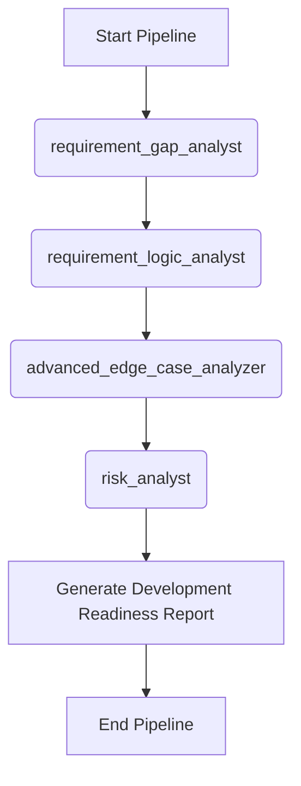

# Workflow: Shift-Left Risk Assessment

> **Controller**: `agents/master_orchestrator.md`

---

## Purpose
Phát hiện sớm các rủi ro, lỗ hổng yêu cầu ngay từ giai đoạn đầu (BA mới viết xong tài liệu) trước khi team Dev bắt đầu code. Nhằm mục đích Shift-Left quá trình đảm bảo chất lượng.

## Execution Order

## Step 1: Requirement & Gap Analysis
- **Agent**: `agents/requirement_gap_analyst.md`
- **Output**: `reports/[Requirement_Name]_Req_Gap_Report.md` (dynamic naming)
- **Objective**: Tìm ra sự mâu thuẫn, thiếu sót logic và khoảng trống truy vết trong tài liệu requirement.

## Step 2: Requirement Logic Anomaly Analysis
- **Agent**: `agents/requirement_logic_analyst.md`
- **Output**: `reports/[Requirement_Name]_Logic_Anomaly_Report.md` (dynamic naming)
- **Template**: `templates/requirement_logic_anomaly_report.md`
- **Objective**: Thử thách tính hợp lý của nghiệp vụ (Business Plausibility), tìm mâu thuẫn nội tại, chuyển trạng thái bất thường và các giả định ngầm trước khi code.

## Step 3: Edge Case Analysis
- **Agent**: `agents/advanced_edge_case_analyzer.md`
- **Output**: `reports/[Requirement_Name]_Edge_Case_Report.md` (dynamic naming)
- **Dependency**: Tận dụng cả `reports/[Requirement_Name]_Logic_Anomaly_Report.md` để đào sâu các trường hợp biên và hành vi bất thường.
- **Objective**: Dò tìm các rủi ro, lỗi hóc búa, hành vi bất thường (concurrency, race condition, state interruption).

## Step 4: Risk Analysis
- **Agent**: `agents/risk_analyst.md`
- **Output**: `reports/[Requirement_Name]_Risk_Analysis_Report.md` (dynamic naming)
- **Dependency**: Sử dụng kết quả từ Gap, Logic Anomaly và Edge Case để đánh giá toàn diện ma trận rủi ro.
- **Objective**: Đánh giá rủi ro (Security, Performance, Business) và đưa ra ma trận rủi ro.

## Step 5: Consolidation
- **Agent**: `agents/master_orchestrator.md`
- **Output**: Báo cáo tổng hợp `reports/[Requirement_Name]_Development_Readiness_Report.md` (dynamic naming).
- **Template**: `templates/executive_summary.md`
- **Objective**: Tổng hợp toàn bộ rủi ro, bất thường logic và khoảng trống yêu cầu để kết luận tính sẵn sàng phát triển (Development Readiness).
