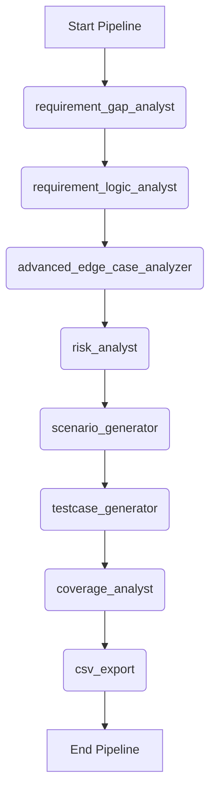

# Workflow: Full QA Test Engineering

> **Controller**: `agents/master_orchestrator.md`

---

## Purpose
Tự động hóa quá trình sinh kịch bản test từ mức high-level đến chi tiết, và cuối cùng là đo lường độ bao phủ (coverage) để đảm bảo không bỏ sót case nào.

## Execution Order

## Step 1: Requirement, Complexity & Gap Analysis
- **Agent**: `agents/requirement_gap_analyst.md`
- **Output**: `reports/[Requirement_Name]_Req_Gap_Report.md` (dynamic naming)
- **Objective**: 
  1. **Đánh giá độ phức tạp (Module Complexity Tier):** Phân loại module vào Tier 1 (30-45 TCs), Tier 2 (45-65 TCs) hoặc Tier 3 (80-120+ TCs) theo `<RULE[module_complexity_evaluation]>` và xác định định mức Test Cases tối thiểu (Target Volume).
  2. **Kiểm tra chất lượng requirement:** Phát hiện lỗ hổng logic, thiếu sót nghiệp vụ và mâu thuẫn trước khi bắt đầu sinh test.

## Step 2: Requirement Logic Anomaly Analysis
- **Agent**: `agents/requirement_logic_analyst.md`
- **Output**: `reports/[Requirement_Name]_Logic_Anomaly_Report.md` (dynamic naming)
- **Template**: `templates/requirement_logic_anomaly_report.md`
- **Objective**: Thử thách tính hợp lý của nghiệp vụ (Business Plausibility), tìm mâu thuẫn nội tại, chuyển trạng thái bất thường và các giả định ngầm trước khi thiết kế kịch bản.

## Step 3: Edge Case Analysis (Mandatory for strict rules)
- **Agent**: `agents/advanced_edge_case_analyzer.md`
- **Output**: `reports/[Requirement_Name]_Edge_Case_Report.md` (dynamic naming)
- **Dependency**: Tận dụng cả `reports/[Requirement_Name]_Logic_Anomaly_Report.md` để đào sâu các điều kiện biên (Boundary), giới hạn dữ liệu (Data constraints), và luồng rẽ nhánh ngầm định (concurrency, race condition, state interruption).
- **Objective**: Chuẩn bị các tình huống góc cạnh, ca kiểm thử khó cho Scenario Generator và Risk Analyst.

## Step 4: Risk Analysis
- **Agent**: `agents/risk_analyst.md`
- **Output**: `reports/[Requirement_Name]_Risk_Analysis_Report.md` (dynamic naming)
- **Dependency**: Sử dụng kết quả từ Gap, Logic Anomaly và Edge Case để đánh giá toàn diện ma trận rủi ro (Security, Performance, Business, Operational).
- **Objective**: Xác định và phân loại mức độ rủi ro để ưu tiên độ sâu kiểm thử cho Test Scenarios và Test Cases.

## Step 5: Scenario Generation
- **Agent**: `agents/scenario_generator.md`
- **Output**: `reports/[Requirement_Name]_Test_Scenarios_Report.md` (dynamic naming)
- **Dependency**: Đọc kết quả từ Requirement, Gap Report, Logic Anomaly, Edge Case và Risk Analysis để sinh ra các Kịch bản kiểm thử (Test Scenarios) cấp cao đầy đủ các chiều.
- **Objective**: Cung cấp khung kịch bản kiểm thử toàn diện, có phân loại mức độ ưu tiên theo rủi ro.

## Step 6: Test Case Generation
- **Agent**: `agents/testcase_generator.md`
- **Output**: `reports/[Requirement_Name]_Testcases.md` (dynamic naming)
- **Objective**: Dựa trên các Scenarios ở trên, sinh ra các Test Cases chi tiết (gồm step-by-step, test data, 14 cột chuẩn).
- **Execution Rules**:
  - Khi tham chiếu hoặc validate về mặt giao diện/hình ảnh (UI/UX), bắt buộc **phải tham chiếu đến các file ảnh trong thư mục `docs/designs/`**.
  - **TUYỆT ĐỐI KHÔNG** sử dụng/tham chiếu các ảnh minh hoạ được nhúng trực tiếp bên trong file FRS (`docs/requirements/*`).

## Step 7: Coverage Analysis
- **Agent**: `agents/coverage_analyst.md`
- **Output**: `reports/[Requirement_Name]_Coverage_Report.md` (dynamic naming)
- **Objective**: Đối chiếu ngược các Test Cases vừa tạo với file Requirement gốc để đảm bảo độ bao phủ 100%. Nếu độ bao phủ chưa đạt 100%, hệ thống bắt buộc phải tự động quay lại Bước 6 để update thêm testcase cho đến khi nào Coverage đạt 100% tuyệt đối.

## Step 8: Finalize & CSV Export (Sync)
- **Tool/Script**: `python scripts/md_to_csv.py`
- **Output**: `reports/[Requirement_Name]_Testcases.csv` (dynamic naming)
- **Objective**: Chỉ thực hiện export ra file CSV MỘT LẦN DUY NHẤT sau khi Coverage Analyst đã xác nhận đạt độ bao phủ (Coverage Passed). Đảm bảo không export file rác khi coverage còn thấp.
