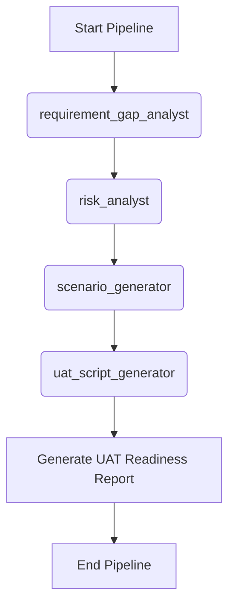

# Workflow: Business Acceptance (UAT Readiness)

> **Controller**: `agents/master_orchestrator.md`

---

## Purpose
Chuẩn bị kịch bản nghiệm thu (UAT) cho khách hàng hoặc business user, đồng thời đối chiếu với các rủi ro để đánh giá hệ thống đã sẵn sàng go-live chưa.

## Execution Order

## Step 1: Baseline Requirement & Gap Check
- **Agent**: `agents/requirement_gap_analyst.md`
- **Output**: `reports/[Requirement_Name]_Req_Gap_Report.md` (dynamic naming)
- **Objective**: Rà soát tài liệu yêu cầu để phát hiện sớm các lỗ hổng logic, điều kiện thiếu sót hoặc mâu thuẫn trước khi tiến hành viết kịch bản nghiệm thu (UAT), đảm bảo kịch bản UAT được xây dựng trên nền tảng yêu cầu vững chắc.

## Step 2: Business Risk Assessment
- **Agent**: `agents/risk_analyst.md`
- **Output**: `reports/[Requirement_Name]_Risk_Analysis_Report.md` (dynamic naming)
- **Dependency**: Đọc báo cáo Gap ở Step 1 để xác định các rủi ro kinh doanh cốt lõi và ưu tiên các kịch bản kiểm thử nghiệm thu quan trọng.

## Step 3: Core Business Flow Extraction
- **Agent**: `agents/scenario_generator.md`
- **Output**: `reports/[Requirement_Name]_Test_Scenarios_Report.md` (dynamic naming)
- **Objective**: Quét tài liệu để trích xuất toàn bộ luồng nghiệp vụ kinh doanh chính (End-to-End User Journeys).

## Step 4: Risk-based UAT Script Generation
- **Agent**: `agents/uat_script_generator.md`
- **Output**: `reports/[Requirement_Name]_UAT_Scripts_Report.md` (dynamic naming)
- **Dependency**: Dùng kết quả từ Risk Analysis và Scenarios để sinh ra các kịch bản UAT thân thiện với người dùng cuối, được tăng cường dựa trên đánh giá rủi ro (Risk-driven).

## Step 5: Consolidation
- **Agent**: `agents/master_orchestrator.md`
- **Output**: Báo cáo tổng hợp `reports/[Requirement_Name]_UAT_Readiness_Report.md` (dynamic naming).
- **Template**: `templates/executive_summary.md` (hoặc cấu trúc UAT readiness)
- **Objective**: Đánh giá và tổng kết mức độ sẵn sàng go-live cho người dùng doanh nghiệp/khách hàng.
